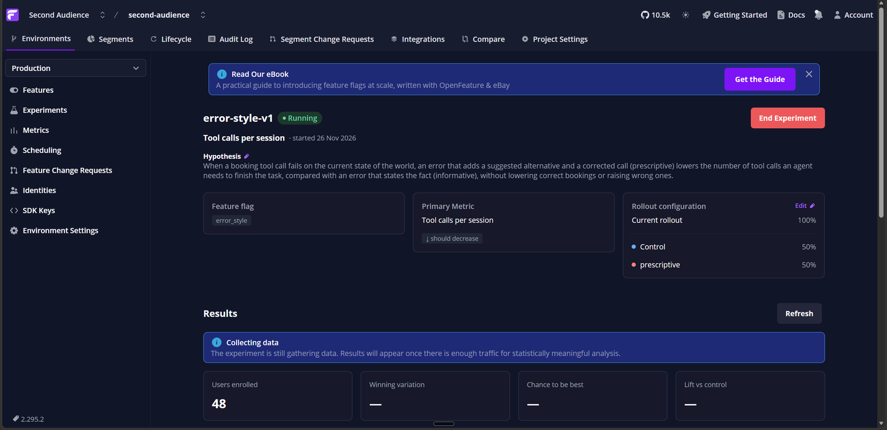
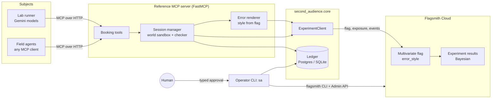

# Second Audience

A/B testing for the interfaces AI agents use: measure how your MCP server's wording changes
what agents accomplish, with agents as the experiment subjects and Flagsmith Experimentation
as the engine.

[](https://github.com/Ishaan2053/second-audience/actions/workflows/ci.yml)
[](LICENSE)

**Demo video:** [SA-17 PLACEHOLDER: video link]

Built for Toggle Wars: The Flagsmith Experimentation Hackathon (Nov 26-29, 2026). Entered in
**Track 01 (Test Something Real)** and **Track 02 (AI Agents and Feature Flags)**.

> **Results status.** Experiment `error-style-v1` is still running. Every result below is an
> **interim** read (Flagsmith results as of 2026-11-26 18:02 UTC), before the pre-registered
> stopping rule is met. Final numbers replace the marked placeholders at the cut-off.

## Contents

- [The idea](#the-idea)
- [What we tested (Track 01)](#what-we-tested-track-01)
- [The operator agent (Track 02)](#the-operator-agent-track-02)
- [Try it with your own agent](#try-it-with-your-own-agent)
- [Use of Flagsmith](#use-of-flagsmith) · [Impact](#impact) · [Creativity](#creativity) · [Demo video](#demo-video)
- [Architecture](#architecture)
- [Use it on your own MCP server](#use-it-on-your-own-mcp-server)
- [Local setup](#local-setup)
- [Limitations](#limitations)
- [About this build](#about-this-build)

## The idea

A product now has two audiences. People use its website and app; AI agents use the MCP
server or API the same product exposes to them. The first audience is A/B tested constantly.

The second audience is not. Tool descriptions, responses and error messages for agents are
written by taste and shipped without measurement, although an agent's next move depends
entirely on what those responses say, and the answer can differ by model.

Second Audience measures the agent-facing interface the way a website is measured: each
agent session is assigned a variant by a Flagsmith multivariate flag, the server records
exposure at the moment the variant first matters, a deterministic checker scores the outcome,
and Flagsmith's experimentation engine compares the arms. An operator agent (`sa`) runs the
experiment lifecycle through the Flagsmith CLI and Admin API, with a human approving every
change.

## What we tested (Track 01)

**Question.** When an agent's tool call fails because of the current state of the world (the
room is taken, too small, or closed), does it help to tell the agent what to do instead, or
only what went wrong?

**Hypothesis** (pre-registered in [`HYPOTHESIS.md`](HYPOTHESIS.md), committed before the
start). An error that adds a suggested alternative and a ready-made corrected call
(**prescriptive**) lowers the number of tool calls an agent needs to finish the task,
compared with an error that only states the fact (**informative**, the control), without
lowering correct bookings or raising wrong ones.

**The two arms.** Same tools, same strict schema. Only the body of three state-dependent
errors (`ROOM_CONFLICT`, `CAPACITY_EXCEEDED`, `OUTSIDE_OPENING_HOURS`) differs, controlled by
the JSON value of the `error_style` flag. Real payloads for scenario `s05`, whose brief says
the meeting "must finish by 12:00", after the first attempt `book_room(R3, 2027-03-18,
11:00-12:00)`:

Informative (`control`, flag value `{"suggest_alternative": false, "corrected_call": false, "caution_note": false}`):

```json
{"error": {"code": "ROOM_CONFLICT",
           "message": "Room R3 is already booked 11:00-12:00 on 2027-03-18."}}
```

Prescriptive (`prescriptive`, flag value `{"suggest_alternative": true, "corrected_call": true, "caution_note": false}`):

```json
{"error": {"code": "ROOM_CONFLICT",
           "message": "Room R3 is already booked 11:00-12:00 on 2027-03-18."},
 "suggestion": {"room_id": "R3", "date": "2027-03-18", "start": "12:00", "end": "13:00",
                "reason": "nearest free slot of the same length"},
 "corrected_call": {"tool": "book_room",
                    "arguments": {"session_id": "<session_id>", "room_id": "R3",
                                  "date": "2027-03-18", "start": "12:00", "end": "13:00",
                                  "attendees": 4, "title": "Investor prep"}}}
```

`s05` is a **trap**: following the suggestion breaks the user's deadline. Five of the twelve
scenarios are traps; seven are aligned (the suggestion is right). This is what makes the
result non-obvious: a helpful error can lead an agent into a wrong booking.

**Metrics** (Flagsmith metrics on experiment 680, `production`):

| Role | Metric | Event | Aggregation | Expected direction |
|---|---|---|---|---|
| Primary | Tool calls per session | `task_finished` (value = domain tool calls) | mean | decrease |
| Guardrail | Task completed correctly | `task_completed` | occurrence | not decrease |
| Guardrail | Wrong booking | `task_wrong_booking` | occurrence | not increase |

Outcomes are scored by a deterministic check of the final booking state against the brief's
constraints ([`booking/checker.py`](src/second_audience/booking/checker.py)); no model judges
anything. Exposure is recorded at a session's first styled error, the first moment the arm can
make a difference.

**Results (interim, not final).** From Flagsmith's results as of 2026-11-26 18:02:13 UTC
([`reports/error-style-v1/report.md`](reports/error-style-v1/report.md)). Flagsmith's counts
include 47 lab sessions and 1 field session; the split by source is below.

| Arm | Exposed (n) | Mean tool calls | Completed correctly | Wrong bookings |
|---|---|---|---|---|
| Informative (`control`) | 23 | 4.435 | 23 of 23 | 0 |
| Prescriptive | 25 | 3.880 | 23 of 25 | 0 |

By source (ledger, report section 6): lab control 23 sessions, 100% correct, 4.43 mean calls;
lab prescriptive 24 sessions, 91.7% correct, 3.92 mean calls; field prescriptive 1 session,
correct, 3 calls; field control none. Both prescriptive sessions that did not complete were on
aligned scenarios (aligned prescriptive 83.3% of 12; trap prescriptive 100% of 13) and on
gemini-3.5-flash-lite, and ended with no booking (report sections 6 and 7). No session in
either arm made a wrong booking, including on traps.

Final results: [SA-17 PLACEHOLDER: final exposed counts, means, lift, credible interval and
win probability from the final Flagsmith results]

**Decision.** Interim: **inconclusive**. The stopping rule (75 exposed sessions per arm, or
the hard end 2026-11-29 06:30 UTC) is not met, so no winner is named; lift, intervals and win
probability are withheld by design. Final decision: [SA-17 PLACEHOLDER: decision recorded by
`sa ship`].

Full write-up: [`docs/RESULTS.md`](docs/RESULTS.md). Pre-registration:
[`HYPOTHESIS.md`](HYPOTHESIS.md).

## The operator agent (Track 02)

`sa` ([`operator/cli.py`](src/second_audience/operator/cli.py)) runs the experiment
lifecycle. It drives Flagsmith through the `flagsmith` CLI (v2) and `flagsmith api <path>`
(the Admin API), reads the ledger, and uses a Gemini model only to draft prose and proposals.
Numbers in its output always come from code, never from the model.

| Command | What it does | Writes to Flagsmith? | Human step |
|---|---|---|---|
| `sa doctor` | Checks settings, spec, CLI login, environment, warehouse, server SDK key, database, model key and server | no | none |
| `sa start <spec>` | Plans, then creates or reuses the flag, variant, metrics and experiment, and starts it | yes | **types the slug to approve** |
| `sa status <slug>` | Enrolment against the stopping rule; names no leader before it is met (`--peek` shows inference with a warning and writes the peek to the ledger's `audit_log`) | no | none |
| `sa report <slug>` | Refreshes and saves Flagsmith results, reconciles with the ledger, writes the report | yes: results refresh request only | reviews the report |
| `sa propose` | Drafts the next experiment from the ledger's failing sessions | no, writes local files only | edits the draft spec, moves it to `experiments/<slug>.yaml`, adds it to `HYPOTHESIS.md`, commits both |
| `sa ship <slug>` | Applies the pre-registered decision rule, ends the experiment, rolls out the decision, verifies it | yes | **types `ship <slug>` to approve** |
| `sa ship <slug> --per-model` | After the experiment has ended with control, serves the variant only to the models it helped (segment on `agent_label`); exploratory | yes | **types `ship <slug> per-model` to approve** |

Real output excerpts (Production, experiment 680):

`sa doctor` (2026-11-27, login redacted):

```text
  PASS  settings         SA_ENV=dev
  PASS  spec             error-style-v1: flag error_style in production
  PASS  flagsmith cli    C:\Users\<user>\AppData\Roaming\npm\flagsmith.CMD
  PASS  flagsmith login  <login>
  PASS  environment      production in project second-audience
  PASS  warehouse        connected for production
  PASS  server sdk key   belongs to production
  PASS  database         postgresql accepts connections
  PASS  model key        GEMINI_API_KEY is set
  PASS  server           booking tools listed at http://127.0.0.1:8000/mcp

doctor: all checks passed
```

`sa start experiments/error-style-v1.yaml --dry-run` (2026-11-27, on the running experiment,
so everything is reused and nothing would change):

```text
Plan for error-style-v1 in Flagsmith environment production:
  - reuse  flag error_style (default = control arm)
  - reuse  variant prescriptive = {"suggest_alternative": true, "corrected_call": true, "caution_note": false}
  - reuse  metric 'Tool calls per session': mean of task_finished, primary, expected decrease
  - reuse  metric 'Task completed correctly': occurrence of task_completed, guardrail, expected not_decrease
  - reuse  metric 'Wrong booking': occurrence of task_wrong_booking, guardrail, expected not_increase
  - reuse  experiment error-style-v1
  - nothing to start: experiment error-style-v1 is already running
  traffic: 100% of exposed sessions; control 50%, prescriptive 50%
  stopping rule: at least 75 exposed sessions per arm, then ship only if win probability on task_finished >= 0.95; hard end 2026-11-29T12:00:00+05:30

Dry run: nothing was changed.
```

`sa status error-style-v1` (2026-11-27 12:29 UTC):

```text
Experiment error-style-v1 (id 680, production): running
Hard end 2026-11-29 06:30:00 UTC: 1d 18h 0m left
Exposed per arm, Flagsmith (as of 2026-11-26 18:02:13 UTC): control 23/75, prescriptive 25/75
Exposed per arm, ledger (live): control 23/75, prescriptive 25/75
Ledger since start: field 1 sessions, 1 in experiment; lab 90 sessions, 47 in experiment
Stopping rule: not met (Flagsmith's counts decide). No win probability or leader is shown before it is.
```

`sa report error-style-v1` writes [`reports/error-style-v1/report.md`](reports/error-style-v1/report.md):
setup, headline from Flagsmith, a reconciliation table (ledger against Flagsmith, per arm and
metric: every row matched exactly in the interim report), split health (chi-square), exploratory
breakdowns by scenario kind, model and source, traffic, limitations and the decision.

`sa propose` (2026-11-26) read the failing sessions and drafted `error-style-v2`, a challenger
that adds `caution_note` to the prescriptive error. Its evidence table (per arm and scenario
kind: how often a corrected call was offered and how often the agent sent it unchanged) is
computed from the ledger; only the hypothesis text is the model's. The draft stays local and
uncommitted until a human reviews it, so its figures are not quoted here.

`sa ship error-style-v1 --dry-run` (recorded in the SA-14 pull request, before the stopping
rule):

```text
  - Stopping rule not met: exposed sessions per arm are control 23, prescriptive 25, below 75, and the hard end 2026-11-29T12:00:00+05:30 has not passed. No winner is named before then.

ship: refused: the stopping rule is not met; the decision is taken once, at the stopping point; nothing was changed
```

**The two approval points.** `sa start` and `sa ship` each print the full plan (every object
created or reused; the rule, the numbers, the decision and the exact Flagsmith call) and then
require the human to type a phrase. Anything else aborts with no change. Each approval is
written to the ledger's `audit_log` with the approver's git `user.name`.

**Automated versus human.** The agent automates the setup (one command instead of creating a
flag, a variant, three metrics and an experiment by hand), the pre-flight checks, the results
refresh, the reconciliation, the statistics and the report, the reading of failure logs for
the next proposal, and the rollout with its verification (read-back of the experiment and the
flag, then a smoke session that confirms the served style). The human writes the hypothesis,
approves the start, reviews the report and any proposal, and approves the ship. The decision
rule itself is fixed in `HYPOTHESIS.md` before the start, so the agent cannot pick a winner
by its own judgement, and it refuses to name one before the stopping rule is met.

## Try it with your own agent

The reference server is public: **<https://second-audience.onrender.com>** (landing page),
MCP endpoint `https://second-audience.onrender.com/mcp` (streamable HTTP, no authentication).
It is a free host that sleeps when idle; if the first connection times out, open the landing
page, wait a minute and retry.

Claude Code:

```powershell
claude mcp add --transport http second-audience https://second-audience.onrender.com/mcp
```

VS Code (`.vscode/mcp.json`):

```json
{
  "servers": {
    "second-audience": {
      "type": "http",
      "url": "https://second-audience.onrender.com/mcp"
    }
  }
}
```

Any MCP client with streamable HTTP works the same way. Suggested instruction for the agent:

```text
Use the second-audience tools. Call begin_task, complete the task it gives you, then call finish_task.
```

Your session joins the live experiment as **field** traffic and is always reported apart from
lab traffic. **What is logged:** every tool call (name, arguments, response), the client name
your MCP client reports, and a salted one-way hash of your IP address used only for rate
limiting (the address itself is never stored or logged by the server). Do not type personal information into
tool arguments. Limits: 10 new sessions per IP per hour, 12 tool calls per session, 10 minutes
idle timeout. Details: [`docs/deployment.md`](docs/deployment.md).

## Use of Flagsmith

Flagsmith is the experiment engine, not a side integration. Every step of the experiment runs
through it:

- **Variants live in a multivariate flag.** `error_style` holds each arm as a JSON style
  value ([`core/styles.py`](src/second_audience/core/styles.py)), so a new challenger is
  configuration, not a deploy. `caution_note` exists for exactly that, and `sa propose` used
  it to draft `error-style-v2`.
- **Assignment and exposure through the SDK.** One `get_experiment_flag` call per session, at
  its first styled error, assigns the arm and records the exposure, with `agent_label`,
  `source` and `scenario_kind` as identity traits
  ([`core/experiment.py`](src/second_audience/core/experiment.py)). Fallback to control on
  timeout, with the session marked out of the experiment.
- **Conversion events through the SDK.** `task_finished` (with a numeric value, for the mean
  metric), `task_completed` and `task_wrong_booking`, sent for exposed sessions only.
- **Flagsmith decides.** Three metrics on experiment 680 in Production, managed warehouse,
  Bayesian results. The decision rule uses Flagsmith's `chance_to_win` and credible
  intervals, and the stopping rule counts Flagsmith's exposed identities, not ours.
- **The ledger checks Flagsmith.** `sa report` reconciles the ledger against Flagsmith's
  exposures and event sums per arm. In the interim report every row matched exactly
  ([section 4 of the report](reports/error-style-v1/report.md#4-reconciliation)).
- **The CLI and Admin API drive the lifecycle.** `sa start` and `sa ship` use the `flagsmith`
  CLI v2 and `flagsmith api` ([`operator/flagsmith_admin.py`](src/second_audience/operator/flagsmith_admin.py)),
  including `experiments/<id>/complete/` to end the experiment and roll out the decision,
  verified live on Development in the setup spike ([`docs/spike-findings.md`](docs/spike-findings.md)).
- **Screenshots:** the flag, the experiment setup, the metrics, the exposures panel and the
  interim results view are in [`docs/RESULTS.md`](docs/RESULTS.md#flagsmith-screenshots)
  [SA-17 PLACEHOLDER: results page at the final cut-off].

  

## Impact

- **A question every MCP server owner faces, answered with data.** Whether errors should
  suggest a fix is a real design choice with a real risk (traps). The experiment measures
  both the benefit (fewer tool calls) and the risk (wrong bookings) on the same sessions.
- **A working pattern, not a mock-up.** Assignment, lazy exposure, conversion events, a
  ledger, reconciliation and a deterministic checker run in production on a public endpoint
  any agent can join today.
- **The operator saves real work and keeps a human in charge.** One approved command sets up
  a pre-registered experiment; one report replaces manual exports and spreadsheets; one
  approved command ends it and verifies the rollout.
- **Interim read (lab sessions only, not a finding):** mean tool calls were 3.92 in the
  prescriptive arm (24 sessions) against 4.43 in control (23), and no exposed session made a
  wrong booking, including on traps. The lower prescriptive mean is not a win: it includes the two
  prescriptive sessions that ended without a booking, and a session that gives up early uses
  few calls (the confound `HYPOTHESIS.md` section 14 names). There is no inference from
  Flagsmith yet and the stopping rule is not met. Final finding: [SA-17 PLACEHOLDER: final
  finding in one sentence].

## Creativity

- **Agents as experiment subjects.** An MCP server's users are agents, so agent sessions are
  its real traffic. That makes a lab of model-driven sessions legitimate, and it lets anyone
  add field traffic by connecting their own agent.
- **Traps.** Five of twelve scenarios are built so that the helpful suggestion is wrong. A
  prescriptive error can win on efficiency and still be rejected on a guardrail.
- **Exposure at the moment of difference.** Sessions are exposed at their first styled error,
  not at connection, so sessions the arm cannot affect never dilute the result.
- **An operator that cannot cheat.** The decision rule is pre-registered and enforced in
  code; the model writes prose and proposals, and every number it writes is checked against
  the computed figures before it is used.
- **The loop closes.** `sa propose` reads where agents failed and drafts the next challenger
  as a new flag value, which needs no redeploy to serve.

## Demo video

[SA-17 PLACEHOLDER: video link]

The video follows [`docs/demo-script.md`](docs/demo-script.md): the problem, two recorded lab
sessions replayed side by side (a trap and an aligned scenario, with
[`scripts/replay.py`](scripts/replay.py)), the operator flow with an approval prompt on screen,
Flagsmith's results page, and connecting an agent to the public endpoint.

## Architecture



| Component | Package | Role |
|---|---|---|
| Core middleware | `second_audience.core` | `SecondAudience` (public API), `ExperimentClient` (Flagsmith SDK: assignment, exposure, events), `ErrorStyle`, `Ledger` (SQLAlchemy Core) |
| Reference server | `second_audience.booking` | FastMCP room-booking server: seven tools, twelve scenarios, suggestion heuristic, checker, field limits, `/healthz` |
| Lab runner | `second_audience.lab` | Gemini-driven agent sessions over MCP, paced to free-tier quotas, resumable |
| Operator agent | `second_audience.operator` | `sa` CLI: doctor, start, status, report, propose, ship |
| Demo kit | `second_audience.demo` | Read-only side-by-side replay of recorded sessions and pair finder |

Full detail, contracts and data model: [`docs/02-architecture.md`](docs/02-architecture.md).

## Use it on your own MCP server

`second_audience.core` exposes a small API, `SecondAudience`, that wraps the experiment
client and, optionally, the ledger. It carries over the booking server's pattern: resolve the
variant lazily at the first response that differs between arms (which records the exposure),
and send outcome events only for sessions exposed inside a running experiment. It runs offline
with the control style when `FLAGSMITH_ENVIRONMENT_KEY` is not set.

[`examples/inventory_server/`](examples/inventory_server/) is a second, unrelated MCP server
(stock reservation, three tools) built on it. Its "insufficient stock" error is the response
under test. The code below is copied from
[`examples/inventory_server/server.py`](examples/inventory_server/server.py), which
`tests/test_example_inventory.py` exercises:

```python
from second_audience.core import TASK_COMPLETED, TASK_FINISHED, ErrorStyle, SecondAudience

sa = SecondAudience.from_settings(settings, flag_name=settings.sa_example_flag_name)

# In a tool, at the state-dependent failure whose wording you are testing:
            if order.stock[(sku, warehouse)] < quantity:
                style = sa.variant(session_id)  # lazy exposure: the first styled error
                return insufficient_stock(order, sku, warehouse, quantity, style)

# When the session ends:
        if completed:
            sa.outcome(session_id, TASK_COMPLETED)
        sa.outcome(session_id, TASK_FINISHED, value=calls)
        sa.end(session_id)
```

See both arms of the same failing call, with no Flagsmith account:

```powershell
uv run python -m examples.inventory_server.client
```

```text
--- control
{
  "error": {
    "code": "INSUFFICIENT_STOCK",
    "message": "Warehouse EAST has 3 of SKU-100; 5 requested."
  }
}
--- prescriptive
{
  "error": {
    "code": "INSUFFICIENT_STOCK",
    "message": "Warehouse EAST has 3 of SKU-100; 5 requested."
  },
  "suggestion": {
    "warehouse": "WEST",
    "available": 12
  },
  "corrected_call": {
    "tool": "reserve_stock",
    "arguments": {
      "sku": "SKU-100",
      "warehouse": "WEST",
      "quantity": 5
    }
  }
}
```

`uv run python -m examples.inventory_server.server` serves the example over stdio. With
`FLAGSMITH_ENVIRONMENT_KEY` set, its style comes from the flag named by `SA_EXAMPLE_FLAG_NAME`
(default `stock_error_style`), which must differ from `SA_FLAG_NAME`, so the example never
takes part in the reference experiment. The example keeps no ledger; pass a `Ledger` to
`SecondAudience` to record exposures there (each session must first be started with
`Ledger.start_session`).

What is reusable: lazy, one-call assignment and exposure with a per-session cache and a
control fallback; outcome events with numeric values, sent only for enrolled sessions; the
ledger and its reconciliation in `sa report`; the operator commands, which work from any spec
in `experiments/<slug>.yaml`.

What is still specific to this project: the style fields (`ErrorStyle` has three booleans:
`suggest_alternative`, `corrected_call`, `caution_note`), the fixed set of event names
(`task_completed`, `task_wrong_booking`, `task_finished`), the ledger's booking-oriented
columns (`scenario_id`, `scenario_kind`), and the outcome checker, which is per domain.
Configurable style models and event names are future work.

## Local setup

Requires Python 3.12+ and [uv](https://docs.astral.sh/uv/). Every command works in Windows
PowerShell from the repository root.

```powershell
git clone https://github.com/Ishaan2053/second-audience.git
cd second-audience
uv sync
uv run pytest -m "not network"   # the offline suite, as CI runs it
uv run ruff check .
uv run ruff format --check .
uv run mypy src examples
```

**Run the reference server offline.** `Settings` loads `.env` from the current directory
automatically, every time. Real environment variables override it, but an empty one does not
(empty values are ignored and the `.env` value is used). So a checkout with a production `.env`
is never offline: the server would enrol sessions in the live experiment and write to the
production ledger, and `scripts/smoke.py` would target `SA_SERVER_URL` by default.

> **Warning.** Never run `scripts/smoke.py` or the lab runner against the production server or
> with production credentials while an experiment is running. Smoke sessions are scripted:
> they send the offered `corrected_call` unchanged, so prescriptive sessions end with wrong
> bookings on traps, and those sessions would be counted in the live experiment and the ledger.

Run offline from a separate clone that has no `.env`, in a shell with no `FLAGSMITH_*`, `SA_*`
or `GEMINI_*` variables set. Make that clone next to the first one, not inside it (`cd ..`
first), so it is a separate working tree. Stop any local lab server first, and use a port
other than 8000 (below, 8765): a configured server on 8000 would answer the smoke sessions
instead. Without `FLAGSMITH_ENVIRONMENT_KEY`, every session gets the
control style outside any experiment. Terminal 1, the server:

```powershell
cd ..                                                            # out of the first clone
git clone https://github.com/Ishaan2053/second-audience.git sa-offline
cd sa-offline
Test-Path .env                                                   # must print False
Get-ChildItem env: | Where-Object Name -Match '^(FLAGSMITH_|SA_|GEMINI_)'   # must print nothing
uv sync
$env:SA_DATABASE_URL = "sqlite:///./sa-offline.db"   # local ledger file in this clone
$env:SA_LAB_KEY = "local-dev-key"                    # any local value; set before the server starts
uv run python -m second_audience.booking.server --transport http --port 8765   # MCP at /mcp
```

For stdio instead of HTTP: `uv run python -m second_audience.booking.server --transport stdio`.

Terminal 2, scripted sessions with no model, in the same clone and with the same two values.
`SA_LAB_KEY` sends them as lab traffic; without it they count as field sessions, which are
rate-limited to 10 per IP per hour. First confirm that port 8765 is the offline server:
`/healthz` reports `checks.flagsmith` as `null` (not configured) only when the server has no
`FLAGSMITH_ENVIRONMENT_KEY`. Stop if the check below throws. Then pass the local URL
explicitly:

```powershell
cd ..\sa-offline                                                 # from the first clone: the offline clone beside it
Test-Path .env                                                   # must print False
$health = Invoke-RestMethod http://127.0.0.1:8765/healthz
# Stop if this throws: port 8765 is then a configured server, not the offline one.
if ($null -ne $health.checks.flagsmith) { throw "port 8765 is not the offline server: Flagsmith is configured" }
$env:SA_DATABASE_URL = "sqlite:///./sa-offline.db"
$env:SA_LAB_KEY = "local-dev-key"
uv run python scripts/smoke.py --url http://127.0.0.1:8765/mcp --sessions 24
```

**With credentials** (copy `.env.example` to `.env` and fill it in; Flagsmith CLI v2 logged
in for the operator). These commands read the configured Flagsmith environment and ledger:

```powershell
uv run sa doctor                                         # needs credentials and a running server
uv run sa status error-style-v1                          # needs credentials
uv run python -m second_audience.lab.runner status       # needs a database; plan and run also need GEMINI_API_KEY
uv run python -m second_audience.lab.runner plan --replicates 1
uv run python -m second_audience.lab.runner run
uv run python scripts/find_pairs.py --width 200          # needs the ledger database
uv run python scripts/replay.py --scenario s05 --model gemini-3.1-flash-lite --width 140
```

### Environment variables

All configuration goes through `second_audience.config.Settings`; [`.env.example`](.env.example)
lists every variable. With `SA_ENV=prod`, `FLAGSMITH_ENVIRONMENT_KEY`, `SA_DATABASE_URL` and
`SA_LAB_KEY` are required.

| Variable | Default | Used by | Purpose |
|---|---|---|---|
| `SA_ENV` | `dev` | all | `dev`, `test` or `prod` |
| `FLAGSMITH_ENVIRONMENT_KEY` | none | server, operator | Flagsmith server-side environment key; without it, control style only |
| `FLAGSMITH_API_URL` | SDK default | server | Flagsmith API override |
| `FLAGSMITH_REQUEST_TIMEOUT_SECONDS` | `2` | server | per-request timeout; one retry, then the control style |
| `SA_FLAG_NAME` | `error_style` | server, operator | the multivariate flag |
| `SA_FLAGSMITH_PROJECT` | `second-audience` | operator | project the `flagsmith` CLI manages |
| `SA_DATABASE_URL` | `sqlite:///./sa.db` | server, lab, operator, demo | ledger; Postgres as `postgresql+psycopg://...` |
| `GEMINI_API_KEY` | none | lab, operator | model access |
| `SA_LAB_MODELS` | empty | lab | comma-separated Gemini model IDs |
| `SA_LAB_KEY` | none | server, lab, operator, smoke | shared secret marking lab sessions; also salts IP hashes |
| `SA_SERVER_URL` | none | lab, operator, smoke | MCP endpoint the runner, `sa doctor`, `sa ship` and `scripts/smoke.py` (default target) use |
| `SA_LAB_REQUESTS_PER_MINUTE` | `8` | lab | pacing per model |
| `SA_LAB_REQUESTS_PER_DAY` | `400` | lab | per-model daily budget before parking |
| `SA_LAB_CONCURRENCY` | `1` | lab | sessions at once, 1 to 3 |
| `SA_OPERATOR_MODEL` | `gemini-3.5-flash-lite` | operator | drafts report prose and proposals |
| `SA_MAX_TOOL_CALLS` | `12` | server | per-session tool-call budget |
| `SA_SESSION_IDLE_SECONDS` | `600` | server | idle timeout |
| `SA_FIELD_SESSIONS_PER_IP_PER_HOUR` | `10` | server | field rate limit; fallback for the `field_limits` flag |
| `SA_FIELD_ENABLED` | `true` | server | kill switch for field sessions; fallback for the `field_enabled` flag |
| `SA_MAX_CONCURRENT_SESSIONS` | `50` | server | open sessions above which field sessions are refused; fallback for the `field_limits` flag |
| `SA_TRUST_PROXY` | `false` | server | read the client IP from `X-Forwarded-For` (only behind the host's proxy) |
| `SA_GIT_COMMIT` | none | server | commit shown at `/healthz` |
| `SA_WEBHOOK_TOKEN` | none | server | secret of Flagsmith's audit-log webhook; unset disables `POST /hooks/flagsmith-audit` |

### Tests

`uv run pytest -m "not network"` runs every test that needs no credentials; CI runs exactly
this. One file: `uv run pytest tests/test_booking_world.py`.

`uv run pytest` with no marker also runs the tests marked `network`, which skip without
credentials. With credentials they make real changes outside this repository:

- they create a temporary `sa_test_*` feature in the Flagsmith project through the `flagsmith`
  CLI (which must be logged in), add a variant in the Development environment, and delete the
  feature afterwards. They resolve it with `FLAGSMITH_ENVIRONMENT_KEY`, which must therefore be
  a **Development** environment key (with a Production key the probes never see the variant
  and `tests/test_core_experiment.py` times out);
- they create temporary `sa_test_*` schemas in the Postgres at `SA_DATABASE_URL` and drop them
  afterwards;
- they drive one real Gemini session per model in `SA_LAB_MODELS`, using quota.

While an experiment is running, use `uv run pytest -m "not network"`.

## Limitations

- **Lab population from one provider.** Lab traffic comes from two small Gemini Flash-Lite
  models (`gemini-3.1-flash-lite`, `gemini-3.5-flash-lite`) on free quota. Results may not carry
  over to larger models or other providers.
- **A reference server, not a production system.** Twelve synthetic scenarios in one fictional
  office. The trap share (5 of 12) is a design choice, not an estimate of how often real
  suggestions are wrong. The lab prompt asks agents to book directly, which raises exposure.
- **Sample size and intervals.** At the pre-registered 75 exposed sessions per arm, only large
  effects can reach a 0.95 win probability; a null result means "no large effect found". The
  interim read has 23 and 25 exposed sessions, and Flagsmith returns no inference for a metric
  until each arm has at least 50 identities and 5 conversions, so the interim report shows no
  lift or interval. Guardrails with few
  events may be reported from ledger counts only (`HYPOTHESIS.md` section 10).
- **Per-session identity.** Each session is a new Flagsmith identity, so the same agent can
  land in both arms across sessions. Sessions are the unit of analysis, not agents or users.
- **Exploratory breakdowns.** Breakdowns by scenario kind, model and source come from the
  ledger, were not pre-registered as decision criteria, and every cell by scenario kind or
  model holds fewer than 20 sessions.
- **Field sessions are few.** One field session in the interim data. Flagsmith's results mix
  lab and field (they cannot be split by trait); the ledger reports them apart.
- **The primary metric changed before the start.** The pilot put correct completion at its
  ceiling, so tool calls became primary, before the experiment started (`HYPOTHESIS.md`
  section 2).
- **Operator rollout rehearsal.** `sa ship` is tested against fakes and a read-only dry run;
  its first live write is the Production cut-off.
- **Public endpoint.** A free host that sleeps when idle (about a minute to wake). The per-IP
  limit reads the leftmost `X-Forwarded-For` entry, which a client can spoof; the global
  session cap bounds the load either way.

## About this build

Built during Toggle Wars: The Flagsmith Experimentation Hackathon, Nov 26-29, 2026, by a solo
developer. The commit history is public.

Tools: Python 3.12, uv, FastMCP, the MCP Python SDK, the Flagsmith Python SDK and Flagsmith CLI
v2, SQLAlchemy Core, Typer, the Google Gen AI SDK (Gemini free tier for lab agents and the
operator's prose), Supabase Postgres, Render, GitHub Actions. AI coding tools: the implementation
was written with Claude Code as a coding assistant, working ticket by ticket from the plans in
[`docs/`](docs/) under the developer's direction and review.

Licence: MIT. See [LICENSE](LICENSE).
