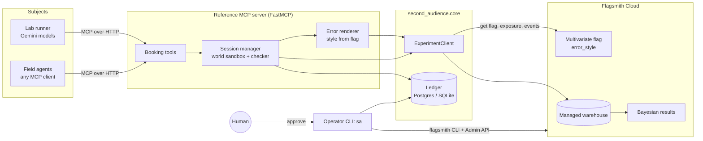
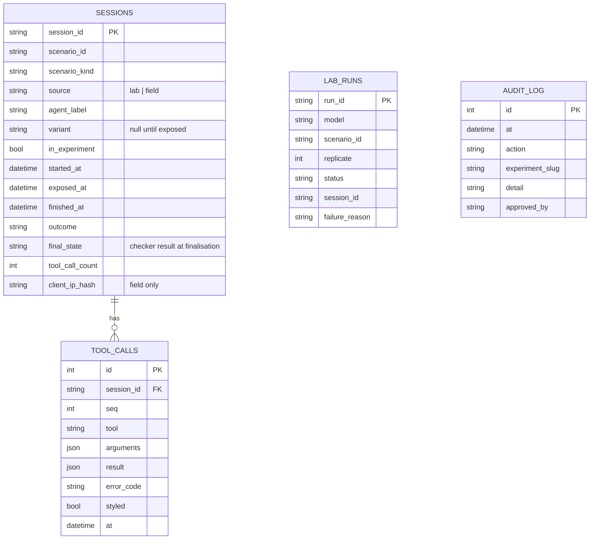
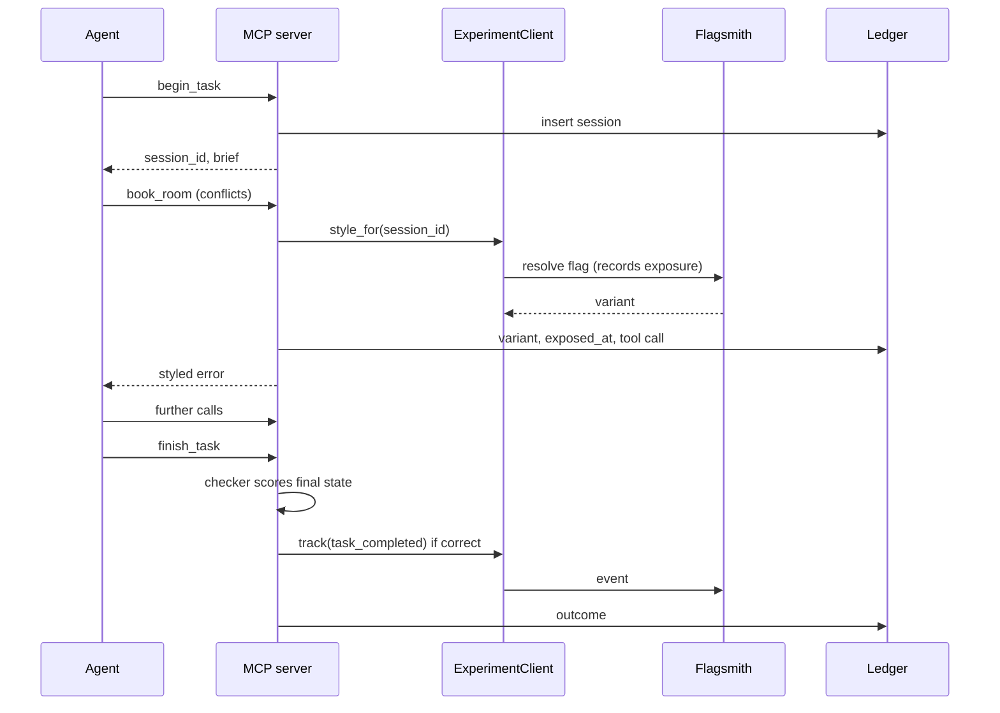

# Technical Architecture

## 1. System overview



## 2. Repository layout

```
second-audience/
  CLAUDE.md  AGENTS.md  README.md  HYPOTHESIS.md  LICENSE
  pyproject.toml  uv.lock  .env.example  Dockerfile
  .github/workflows/ci.yml
  experiments/error-style-v1.yaml
  reports/                      generated reports and saved results JSON
  docs/
  src/second_audience/
    config.py                   Settings (pydantic-settings)
    core/
      experiment.py             ExperimentClient (Flagsmith SDK wrapper)
      ledger.py                 Ledger (SQLAlchemy Core)
      styles.py                 ErrorStyle config parsed from the flag value
    booking/
      world.py                  rooms, bookings, fixed clock
      scenarios.py              scenario definitions
      checker.py                final-state correctness check
      errors.py                 state-dependent errors and rendering
      suggestions.py            suggestion heuristic
      sessions.py               session lifecycle and budgets
      server.py                 FastMCP app and tools
    lab/
      models.py                 ModelClient protocol, Gemini implementation
      plan.py                   run matrix
      runner.py                 agent loop, pacing, resume
    operator/
      cli.py                    Typer app: sa
      flagsmith_admin.py        CLI and Admin API wrapper
      spec.py                   experiment spec model
      report.py  propose.py  ship.py
  tests/
```

## 3. Components and contracts

### 3.1 Configuration (`config.py`)

One `Settings` class, validated at start-up. Missing required values fail fast with a clear message.

| Variable | Used by | Purpose |
|---|---|---|
| `SA_ENV` | all | `dev`, `test` or `prod` |
| `FLAGSMITH_ENVIRONMENT_KEY` | server | SDK key for the Flagsmith environment |
| `FLAGSMITH_API_URL` | server | optional override |
| `SA_FLAG_NAME` | server | default `error_style` |
| `SA_DATABASE_URL` | server, operator | ledger; default `sqlite:///./sa.db` |
| `GEMINI_API_KEY` | lab, operator | model access |
| `SA_LAB_MODELS` | lab | comma-separated model IDs |
| `SA_LAB_KEY` | server, lab | shared secret marking lab sessions |
| `SA_SERVER_URL` | lab | MCP endpoint the runner targets |
| `SA_MAX_TOOL_CALLS` | server | per-session budget, default 12 |
| `SA_SESSION_IDLE_SECONDS` | server | default 600 |
| `SA_FIELD_SESSIONS_PER_IP_PER_HOUR` | server | default 10 |

The Flagsmith admin credential is never stored in this project. The operator shells out to
the `flagsmith` CLI, which holds its own login.

### 3.2 Booking domain (`booking/`)

A fictional office with six rooms. Each room has an ID, capacity, features (projector,
whiteboard, video) and opening hours. The clock is fixed to one working week so that tasks
use explicit ISO dates and no date arithmetic is needed. Times are local, on 30-minute steps.

World state is created per session from the scenario's seed bookings and held in memory.
Sessions cannot see or affect each other.

**Tools (identical schema in both arms):**

| Tool | Arguments | Notes |
|---|---|---|
| `begin_task` | `scenario_id?` | Creates a session; returns `session_id`, the task brief and the call budget. |
| `list_rooms` | `session_id` | |
| `check_availability` | `session_id, room_id, date` | Free slots for that room and date. |
| `book_room` | `session_id, room_id, date, start, end, attendees, title` | |
| `reschedule_booking` | `session_id, booking_id, date, start, end` | |
| `cancel_booking` | `session_id, booking_id` | |
| `finish_task` | `session_id, summary` | Finalises and scores the session. Idempotent. |

Every tool takes `session_id` explicitly. **Why:** it works over any transport, does not
depend on a client preserving an MCP session header, and is trivial to test.
**Alternative considered:** binding to the MCP transport session; rejected because client
behaviour varies and the public endpoint must accept any client.

**Schema strictness.** Dates, times, enumerated room IDs and integer ranges are enforced by
the schema. Schema failures return the same plain validation message in both arms and are
not part of the experiment.

### 3.3 State-dependent errors and styles (`booking/errors.py`, `core/styles.py`)

Styled error codes: `ROOM_CONFLICT`, `CAPACITY_EXCEEDED`, `OUTSIDE_OPENING_HOURS`.
Unstyled (same in both arms): `BOOKING_NOT_FOUND`, `BOOKING_CANCELLED`, `SESSION_NOT_FOUND`,
`BUDGET_EXHAUSTED`.

The flag value is a JSON string parsed into `ErrorStyle`:

```json
{"suggest_alternative": false, "corrected_call": false, "caution_note": false}
```

| Arm | Flag value |
|---|---|
| `control` (informative) | all false |
| `prescriptive` | `suggest_alternative: true`, `corrected_call: true` |

`caution_note` exists so that a future challenger can be created from configuration alone,
without a redeploy. It is not used in experiment 1.

Informative payload:

```json
{"error": {"code": "ROOM_CONFLICT",
           "message": "Room R2 is already booked 14:00-15:00 on 2027-03-15."}}
```

Prescriptive payload adds:

```json
{"suggestion": {"room_id": "R2", "date": "2027-03-15", "start": "15:00", "end": "16:00",
                "reason": "nearest free slot of the same length"},
 "corrected_call": {"tool": "book_room", "arguments": {"...": "..."}}}
```

**Suggestion heuristic (fixed before the experiment starts).**

- Conflict: same room, nearest free slot of the same length on the same day (ties go later);
  if none, the smallest other room free at the requested time.
- Capacity: the smallest room with enough capacity free at the requested time; if none,
  that room's nearest free slot.
- Opening hours: the nearest in-hours slot in the same room.

The heuristic knows nothing about the user's time window or required features. That is
realistic, and it is what makes trap scenarios possible.

### 3.4 Scenarios and correctness (`scenarios.py`, `checker.py`)

Twelve scenarios, each built so the obvious first attempt hits a styled error.

- **Aligned (7):** the heuristic's suggestion satisfies the brief.
- **Trap (5):** the suggestion violates the brief (ends after a stated deadline, lacks a
  required feature, or is too small).

A scenario defines: `id`, `kind`, `brief`, seed bookings, and constraints (date, allowed
time window, duration, attendees, required features).

**Outcome at finalisation:**

| Outcome | Meaning |
|---|---|
| `correct` | Exactly one active agent-made booking, and it satisfies every constraint. |
| `incorrect` | At least one active agent-made booking, and the state is not correct. |
| `no_booking` | No active agent-made booking. |
| `budget_exhausted` | Call budget reached before `finish_task`. The final state is still scored and stored as `final_state`, and events follow it. |
| `abandoned` | Idle timeout or server restart. |

Finalisation triggers: `finish_task`, budget exhaustion, or idle timeout.

### 3.5 Experiment client (`core/experiment.py`)

```python
class ExperimentClient(Protocol):
    def style_for(self, session_id: str) -> tuple[ErrorStyle, str | None]: ...
    def track(self, session_id: str, event: str) -> None: ...
    def flush(self) -> None: ...
```

- `style_for` is called the first time a session needs a styled error. It resolves the
  flag for the identity `session_id`, which also records the exposure, and caches the
  result on the session. Returns the style and the variant key.
- **Lazy exposure. Why:** a session that never hits a styled error is unaffected by the
  variant; counting it would dilute the result. Whether a session reaches its first styled
  error does not depend on the arm, so this keeps the comparison valid.
  **Alternative considered:** exposure at `begin_task`; simpler, kept as the fallback if
  the SDK makes lazy evaluation awkward.
- If Flagsmith is unreachable, the client returns the control style with variant `None`,
  and the ledger marks the session `in_experiment = false`.
- Events: `task_completed` when the outcome is `correct`; `task_wrong_booking` when it is
  `incorrect`. Sent only for sessions that were exposed.
- A `NullExperimentClient` with a fixed style is used in tests and offline runs.

Exact SDK method names, the events flag and minimum versions are confirmed in SA-02 and
recorded in `docs/spike-findings.md`.

### 3.6 Ledger (`core/ledger.py`)

SQLAlchemy Core, one code path for SQLite (tests, offline) and Postgres (the real run).
**Why a ledger in addition to Flagsmith:** per-model and per-scenario breakdowns, failure
transcripts for the operator, reconciliation against Flagsmith's counts, and proof of
where traffic came from.



### 3.7 Lab runner (`lab/`)

For each planned run (model x scenario x replicate), the runner opens an MCP client
connection to `SA_SERVER_URL`, calls `begin_task` itself, hands the brief and tool list to
the model, and loops on function calls until the model stops or a turn limit is reached.
It then calls `finish_task` if the model did not.

- `ModelClient` is a small protocol with one Gemini implementation. This is the only
  abstraction added for a contingency (SA-19).
- The runner never learns the variant. The server does not return it.
- The system prompt is fixed and recorded in `HYPOTHESIS.md`.
- Pacing respects per-model request limits. A daily-quota error parks that model until the
  next reset. Runs are resumable from the `lab_runs` table.
- Lab sessions identify themselves with the `SA_LAB_KEY` header and an agent label.
  Sessions without a valid key are recorded as `field`.

### 3.8 Operator agent (`operator/`, command `sa`)

| Command | What it does | Approval |
|---|---|---|
| `sa doctor` | Checks settings, CLI login, warehouse connection, database, model key. | none |
| `sa propose` | Reads failing sessions from the ledger, drafts an experiment spec and rationale. | human edits and commits the file |
| `sa start <spec>` | Shows the plan, then creates the flag, variants, metrics and experiment, and starts it. | typed confirmation |
| `sa status <slug>` | Enrolment, stopping-rule progress. Refuses to name a winner early. | none |
| `sa report <slug>` | Refreshes and saves results, builds the Markdown report. | none |
| `sa ship <slug>` | Ends the experiment and sets the winning value on the flag, or records a no-ship decision. | typed confirmation |

Every mutating action is written to `audit_log`. The spec file format is defined in SA-09.

### 3.9 Public endpoint

One container on a free host, serving MCP over streamable HTTP at `/mcp`, a plain landing
page at `/` (what this is, what is logged, how to connect) and `/healthz`.

Protection: per-IP session rate limit, per-session call budget, idle timeout, a cap on
concurrent sessions, and no personal data in the ledger (IP stored only as a salted hash).

## 4. Flagsmith setup

| Item | Value |
|---|---|
| Project | `second-audience` |
| Environments | `development` (smoke and pilot), `production` (the reported experiment) |
| Warehouse | Flagsmith managed warehouse, enabled on both environments |
| Flag | `error_style`, multivariate; control value = informative JSON; variant key `prescriptive` |
| Metrics | `task_completed` (occurrence, up, primary); `task_wrong_booking` (occurrence, down) |
| Split | 100% of exposed sessions, 50/50 |

## 5. Session sequence



## 6. Key decisions

| Decision | Choice | Why | Alternatives considered |
|---|---|---|---|
| Language | Python | Developer's daily stack; the organisers' walkthrough uses the Python SDK for experiments. | TypeScript: docs warn the older Node SDK cannot send events. |
| MCP framework | FastMCP | Least code for tools and HTTP transport. | Low-level MCP SDK: more control, more boilerplate. |
| Flagsmith control plane | CLI plus Admin API | Flagsmith's own agent prompt uses this path and says its MCP server cannot start experiments. | Flagsmith MCP server. |
| Success metric | Deterministic state check | Objective and cheap; no judge model. | LLM judge: costs quota and adds noise. |
| Ledger store | Postgres via `SA_DATABASE_URL`, SQLite fallback | The free host's disk is ephemeral; lab and field must share one ledger. | SQLite only: data lost on restart. |
| Variant as configuration | Flag value is a style JSON | A new variant can be rolled out without a redeploy. | Variant names mapped to code paths. |
| Agent loop | Custom loop on the Gemini SDK and MCP client | Small, transparent, no framework behaviour to explain. | Agent frameworks. |

## 7. Observability and error handling

- Structured logs (JSON lines) with `session_id` on every server log line.
- The server never raises raw exceptions to clients; unknown errors return a generic
  `INTERNAL_ERROR` and are logged with a traceback.
- `sa doctor` is the single health check for local setup; `/healthz` for the deployment.
- `sa report` includes a reconciliation table comparing ledger counts with Flagsmith's.
